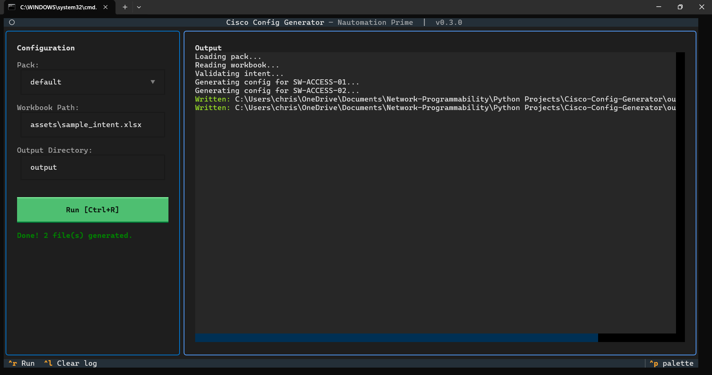

# Cisco Config Generator

[](https://github.com/Nautomation-Prime/Cisco-Config-Generator/actions/workflows/test.yml)

> A ready-to-run Windows tool that generates per-device Cisco IOS-XE access switch
> configuration files from an Excel intent workbook. **No Python installation required.**
> Built by **[Nautomation Prime](https://nautomationprime.io)**.

---

## Documentation

| Document | Covers |
|---|---|
| [docs/RUNBOOK.md](docs/RUNBOOK.md) | Install, fill the workbook, generate, review, deploy to a switch, roll back |
| [docs/RUNBOOK-PACK-AUTHORING.md](docs/RUNBOOK-PACK-AUTHORING.md) | Customising a pack — full settings reference, AAA policy, templates |
| [docs/RUNBOOK-TROUBLESHOOTING.md](docs/RUNBOOK-TROUBLESHOOTING.md) | Every error message, and deployment failure modes |

---

## Overview

The Cisco Config Generator reads network intent from a structured Excel workbook plus one
YAML file per site, and renders per-device `.cfg` files using Jinja2 templates. It ships with
a self-contained Python runtime so it runs straight from the folder you download — no software
to install, no admin rights needed.

It is designed as a customisable product:
the core Python engine never needs to change between customers — all customer-specific
templates and policy live in a **pack** folder, while each deployment's own facts split
cleanly into per-device (the workbook) and per-site (`sites/<name>.yaml`).

```text
Excel workbook (devices/ports) + sites/<name>.yaml (VLANs/ACLs/NTP/AAA/...) → Python core → Jinja2 templates → per-device .cfg files
```



---

## Quick Start

### 0. Download

Head to the **[Releases page](https://github.com/Nautomation-Prime/Cisco-Config-Generator/releases)** on GitHub, download the latest ZIP, extract it anywhere on your machine, and open the folder.

> Alternatively, clone the repository with `git clone https://github.com/Nautomation-Prime/Cisco-Config-Generator.git`.

### 1. First-time Setup (one-time only)

```bat
setup.bat
```

This downloads a portable Python 3.12 runtime and installs all dependencies **into the tool's own folder**.
Nothing is installed system-wide. An internet connection is required for this step only.

### 2. Define your site, then fill in your intent workbook

Copy `sites/site-a.yaml` to `sites/<your-site>.yaml` and fill in your VLANs, ACLs,
NTP/DNS/SNMP servers, AAA and credentials — see [Site-Aware Configuration](#site-aware-configuration)
below.

A **pre-filled sample workbook** is included at `assets/sample_intent.xlsx` (using `sites/site-a.yaml`)
— open it to see a complete two-switch example before building your own.

To generate a blank template:

```bat
python_runtime\python.exe scripts\generate_workbook.py
```

This creates `assets/workbook_template.xlsx`, with a Site dropdown and Site Reference sheet
built from whatever `sites/*.yaml` files exist at that point. Open it, fill in your intent
(including which Site each device belongs to), and save.
You only need to add interface rows for ports that need non-default behaviour; the generator derives the full port inventory from each device's selected model and uplink module, and treats omitted ports as unused.

### 3. Run the tool

```bat
run.bat
```

The interactive TUI will launch. Select your pack, point to your workbook, and click **Run**.

### Headless (no TUI)

```bat
python_runtime\python.exe -m cisco_config_generator --no-tui --workbook assets\workbook_template.xlsx
```

Generated configs are written to `output\<hostname>.cfg`.

---

## CLI Reference

```
run.bat [OPTIONS]
python_runtime\python.exe -m cisco_config_generator [OPTIONS]

Options:
  -p, --pack TEXT       Pack name (folder under packs/) or full path  [default: default]
  -w, --workbook PATH   Path to the intent workbook (.xlsx)
  -o, --output TEXT     Directory to write generated config files     [default: output]
  --sites-dir PATH      Directory containing per-site YAML files      [default: sites/, next to packs/]
  --no-tui              Run headless without the interactive TUI
  --version             Print version and exit
```

---

## Site-Aware Configuration

Shared, site-level facts — VLANs, ACLs, NTP/DNS/SNMP servers, AAA, banner,
credentials — live in **`sites/<name>.yaml`**, one file per site, not in the
Excel workbook. The workbook only carries per-device facts (hostname, IPs,
ports) plus a **Site** column that picks which `sites/<name>.yaml` supplies
the rest. A single workbook can mix devices from several sites; each device
renders against its own site's file.

Copy `sites/site-a.yaml` as a starting point — it's a complete, commented
example (fictional addresses/credentials). See
[docs/RUNBOOK.md](docs/RUNBOOK.md#31-the-site-yaml) for the full field
reference.

```yaml
# sites/london.yaml
domain_name: london.example.com
ntp_servers: [10.10.0.1, 10.10.0.2]
enable_secret: "EXAMPLE-enable-secret"
vlans:
  - { vlan_id: 10, vlan_name: MGMT, description: "Management VLAN" }
  - { vlan_id: 20, vlan_name: DATA, description: "User Data VLAN" }
acls:
  - { acl_name: ACL_VTY_ACCESS, action: permit, network: 10.10.0.0, wildcard: 0.0.0.255 }
  - { acl_name: ACL_VTY_ACCESS, action: deny, network: any }
```

Run `python scripts/generate_workbook.py` **before** copying the template for
a new site — it refreshes the workbook's **Site Reference** sheet and the
Devices sheet's Site dropdown from whatever `sites/*.yaml` files exist at that
moment. That's a one-time snapshot baked into `workbook_template.xlsx`, not a
live lookup: a workbook copied earlier won't offer a site added afterwards,
and Excel's dropdown validation blocks typing one in directly. Editing values
inside an existing site file needs no regeneration — only adding a new site
does. See [docs/RUNBOOK.md](docs/RUNBOOK.md#8-routine-operations) for the
full workflow.

---

## ACL Workflow

ACLs are defined in a site's `acls:` list and referenced by name in that same
site's global settings.

**Step 1 — Define ACLs in `sites/<name>.yaml`:**

```yaml
acls:
  - { acl_name: ACL_VTY_ACCESS, remark: "Management hosts", action: permit, network: 10.0.0.0, wildcard: 0.0.0.255 }
  - { acl_name: ACL_VTY_ACCESS, action: deny, network: any }
  - { acl_name: ACL_SNMP_RO_ACCESS, remark: "NMS server", action: permit, network: 10.1.1.100 }
  - { acl_name: ACL_SNMP_RO_ACCESS, action: deny, network: any }
```

- Leave **wildcard** unset for host entries (`permit 10.1.1.100`) or `deny any`
- An entry with only `remark` set (no `action`/`network`) renders as a standalone comment line before permit/deny lines

**Step 2 — Reference ACL names in the same site file:**

| Setting | Example Value |
|---------|---------------|
| `vty_acl` | ACL_VTY_ACCESS |
| `snmp_ro_acl` | ACL_SNMP_RO_ACCESS |
| `snmp_rw_acl` | ACL_SNMP_RW_ACCESS |

The generator validates that every ACL name a site references is defined in that same site's `acls:` list. To disable ACL generation entirely, set **ACLs → No** in the Feature Selection sheet.

---

## Excel Workbook Sheets

| Sheet | Purpose |
|-------|---------|
| **Devices** | One row per switch — hostname, IP, model, uplink module, **Site** (which `sites/<name>.yaml` supplies this device's VLANs/ACLs/NTP/DNS/SNMP/AAA/banner), timezone label, timezone hour/minute offsets |
| **Site Reference** | Read-only. Lists every `sites/*.yaml` file found when the workbook was generated, with its VLAN IDs/names and ACL names — not read back by the generator |
| **Interfaces** | Add rows only for ports that need explicit config — the generator derives the full per-device interface inventory from the selected model and uplink module, and any omitted ports default to unused/shutdown |
| **Port-Channels** | Optional — port-channels are derived automatically from the Port Channel No. column in Interfaces, taking their settings from the first member. Add a row only to make a Port-channel differ from its members; blank cells keep the members' values |
| **Feature Selection** | Toggle which config sections to generate (Yes/No) |

---

## Pack System

All customer-facing configuration lives in `packs/<name>/`:

```
packs/default/
├─ settings.yaml          # Pack policy defaults - every opinionated choice
│                         # in the templates is a knob here
├─ hardware_catalog.yaml  # Switch models and uplink modules
├─ port_profiles.yaml     # Port profile definitions
├─ template_map.yaml      # Maps profiles/features to Jinja2 templates
├─ features.yaml          # Feature toggle defaults
└─ templates/
   ├─ acls.j2
   ├─ base.j2
   ├─ vlans.j2
   ├─ interfaces_access.j2
   ├─ interfaces_access_server.j2
   ├─ interfaces_trunk.j2
   ├─ interfaces_trunk_portchannel.j2
   ├─ interfaces_trunk_server.j2
   ├─ interfaces_ap_trunk.j2
   └─ interfaces_unused.j2
```

To create a customer pack:
1. Copy `packs/default/` to `packs/<customer-name>/`
2. Edit the templates and YAML files
3. Select the pack in the TUI or via `--pack <name>`

### Pack policy defaults

`settings.yaml` carries a `defaults:` block that the templates read as
`settings.defaults.<key>`. Every value shipped there is a recommended starting
point, not a hard-coded decision — change it per pack without touching a
template. Keys a pack omits fall back to the `PackDefaults` model in
`cisco_config_generator/pack_schema.py`, so packs written against an earlier
schema keep working. Every pack file is validated against that schema on load:
a misspelt key or an invalid value stops the run with a message naming the file
and key, rather than quietly falling back to a default. JSON schemas in
`schemas/` give pack authors autocomplete and inline errors in VS Code.

Some of the choices worth knowing about:

| Setting | Default | Notes |
|---|---|---|
| `service_internal` | `false` | Undocumented Cisco-internal debug commands; unsupported in production |
| `service_call_home` | `false` | Emits `no service call-home` when off |
| `password_hash_type` | `scrypt` | Used when the site holds a *plaintext* secret, so the switch hashes it (`enable algorithm-type scrypt secret …`). Values already hashed (`$9$…`, `$8$…`, `$1$…`) are passed through with their own type number |
| `ntp_mode` | `server` | Client mode, correct for an access switch. `peer` is symmetric-active and only suits mutually redundant time servers |
| `logging_console_level` | `""` | Empty emits `no logging console`. Set a level name to log to the console instead |
| `ssh_mac_algorithms` | `hmac-sha2-512 hmac-sha2-256` | Leave empty to keep the platform default set |
| `emit_crypto_key_command` | `false` | `crypto key generate rsa` is an EXEC command and is rejected in config mode, so it is emitted as a documented post-apply step in the file header. Set `true` to emit it as a live line anyway |
| `qos_enabled` | `false` | On IOS classic (2960-X) `mls qos trust` does nothing without global `mls qos`, so neither is emitted. Turning this on emits both, and trusts uplinks (`qos_trust_uplinks`) so upstream DSCP is not remarked to 0 |
| `storm_control_action` | `trap` | `errdisable recovery cause storm-control` only ever fires when this is `shutdown` |
| `domain_lookup` | `false` | `true` emits `ip domain lookup` plus a source interface; only meaningful alongside `dns_servers` |
| `logging_source_interface` / `ntp_source_interface` / `snmp_source_interface` | `true` | Source syslog, NTP and SNMP traps from the management SVI |

### `strict_validation`

A top-level key in `settings.yaml` (a sibling of `defaults:`, not inside it),
default `true`. It only affects a small set of *hardening recommendations* —
placeholder credentials (`enable_secret`/`local_password` left as `changeme`)
and AAA servers configured with no local-account fallback. With
`strict_validation: true` those block generation like any other validation
error; with `false` they are logged as warnings instead and generation
proceeds. Every other check — invalid addresses, undefined VLAN/ACL
references, an empty AAA shared secret, an unknown site — always blocks
generation regardless of this setting, since those would either fail to
render or leave the switch in a broken state.

### AAA

The site YAML says *who* — `aaa_protocol`, `aaa_servers` (any number, a YAML
list or comma-separated), `aaa_key`, `aaa_key_type`, `aaa_group_name`,
`aaa_fail_message` — and the pack's `settings.defaults.aaa` block says *how*.
Each method list is a string emitted verbatim after the command it belongs
to, with `{group}` substituted for the site's group name:

```yaml
aaa:
  source_interface: true
  authorization_console: true
  session_id: common
  authentication:
    login:  "group {group} local"
    enable: "group {group} enable"
  authorization:
    exec: "group {group} local"
    commands: [15]                   # [] to omit command authorization
    commands_methods: "group {group} local"
  accounting:
    exec: "start-stop group {group}"
    commands: [15]                   # [] to omit command accounting
    commands_methods: "start-stop group {group}"
  local_only:                        # used when no servers are defined
    login: "local"
    exec: "local if-authenticated"
```

So local-first ordering (`"local group {group}"`), a `none` fallback for a lab,
privilege level 1 alongside 15, command authorization off entirely, or RADIUS
instead of TACACS+ are all settings changes rather than template edits. Nested
keys merge, so overriding `aaa.authorization.commands` keeps every sibling
default.

Two guard rails, because AAA misconfiguration is how switches get bricked:

- The pack **fails to load** if `authentication.login` or
  `authorization.commands_methods` has no fallback method (`local`,
  `if-authenticated`, `none`, `enable`). Without one, unreachable AAA servers
  lock everyone out.
- Validation **fails** if `aaa_servers` is set with no `aaa_key`, or with no
  `local_username` to fall back to (the latter is downgraded to a warning
  when the pack sets `strict_validation: false` — see below).

Setting the `aaa` feature to **No** in Feature Selection skips `aaa new-model`
entirely and puts `login local` on the console and both vty ranges instead.

### Platform gating

IOS-XE-only commands (`no platform punt-keepalive disable-kernel-core`,
`vrf definition Mgmt-vrf`, `no device-tracking logging theft`, `boot system`,
`license boot level`, `redundancy`) are emitted only for Catalyst 9200/9300
models. A Catalyst 2960-X gets a config it can actually parse.

### Section order

`template_map.yaml` sets the render order so a generated file can be pasted top
to bottom without forward references: ACLs (5) → VLANs (10) → base config (15)
→ port-channels (25) → physical interfaces (30). That puts ACLs before the
`access-class` lines that apply them, VLANs before the management SVI, and each
`interface Port-channel` before the members that join it.

---

## Template Context

All Jinja2 templates receive:

```python
{
  "device":     Device,           # hostname, mgmt_ip, model, timezone, site, offsets...
  "vlans":      [VLAN],           # this device's site's VLANs
  "interfaces": [Interface],      # interfaces for this device (filtered per template group, including allowed_vlans, storm control, and port-channel data)
  "global":     GlobalSettings,   # this device's site's NTP, SNMP, AAA, banner, ACL names...
  "hardware":   HardwareProfile,  # port counts and interface naming
  "acls":       [ACLEntry],       # this device's site's ACL entries (for acls.j2)
  "features":   FeatureSelection, # feature flags (base_config, vlans, interfaces, acls)
  "settings":   {"defaults": {}}  # the whole merged settings.yaml defaults block
}
```

`vlans`, `global` and `acls` come from the site YAML the device's Site column
points at (see the [Site-Aware Configuration](#site-aware-configuration)
section above) — a multi-site workbook renders each device against its own
site's values.

Templates also get a `cisco_secret` filter, which renders the secret portion of
an `enable` or `username` command — `algorithm-type <type> secret <plaintext>`
for a plaintext value, or `secret <type> <hash>` for one that is already hashed.

---

## Hardware Catalog

Supported switch models and uplink modules are defined in `hardware_catalog.yaml`.

| Switch Model | Access Ports |
|---|---|
| C9200-48P | 48 |
| C9200-24P | 24 |
| C9300-48P | 48 |
| C9300-24P | 24 |
| C2960X-48FPD-L | 48 |
| C2960X-48FPS-L | 48 |
| C2960X-24PD-L | 24 |

| Uplink Module | Ports |
|---|---|
| NM-4X | 4 × 10G SFP+ |
| NM-8X | 8 × 10G SFP+ |
| C9200-NM-4X | 4 × 10G SFP+ |
| NONE | No uplink module |

---

## Port Profiles

| Profile | Type | Notes |
|---------|------|-------|
| `access-user` | Access | Standard PC port |
| `access-voip` | Access + Voice VLAN | Data + voice VLAN, QoS DSCP trust |
| `access-printer` | Access | Printer port |
| `access-video` | Access | Video device, QoS DSCP trust |
| `access-special` | Access | Special purpose |
| `access-control` | Access | Door entry / access control |
| `access-server` | Access | Server port |
| `access-ap` | Access | Wireless AP (access mode) |
| `access-ap-trunk` | Trunk | Wireless AP (trunk mode, native VLAN = AP VLAN) |
| `trunk-uplink` | Trunk | Uplink to core/distribution |
| `trunk-uplink-portchannel` | Trunk + Port-Channel | Uplink with port-channel |
| `trunk-server` | Trunk | Server trunk port |
| `unused` | Disabled | Unused/shutdown port |

---

## Running Tests

```bat
python_runtime\python.exe -m pytest tests/ -v
```

---

## Requirements

- Windows 10 / Windows 11 (64-bit)
- Internet connection for first-time setup only — the portable Python 3.12 runtime is downloaded once and stored in the `python_runtime\` folder
- No Python installation required — the runtime is fully self-contained

> **Developers / contributors:** a standard `.venv` is also supported. Run `pip install -e .[dev]` to get the editable install with pytest.

---

## Project Structure

```
Cisco-Config-Generator/
├─ cisco_config_generator/   # Core Python package
│  ├─ workbook/              # Excel parsing and validation
│  ├─ rendering/             # Jinja2 engine and file writer
│  └─ tui/                   # Textual interactive UI
├─ docs/                     # Runbooks
├─ packs/                    # Customer packs (YAML + templates)
├─ schemas/                  # JSON schemas for pack and site YAML (editor autocomplete)
├─ sites/                    # Per-site YAML (VLANs, ACLs, NTP/DNS/SNMP/AAA, banner)
├─ scripts/                  # Utility scripts
├─ assets/                   # Generated workbook template
├─ output/                   # Generated config files
├─ tests/                    # pytest test suite
├─ setup.bat                 # First-time setup
└─ run.bat                   # Launch the tool
```

---

## About Nautomation Prime

The Cisco Config Generator is part of the **[Nautomation Prime](https://nautomationprime.io)** collection of practical network automation tools and learning resources.
Visit the website to discover more tools, read guides, and explore showcase projects built around real-world network engineering.

## License

Apache License 2.0 — see [LICENSE](LICENSE) and [NOTICE](NOTICE). Free to use, modify and redistribute. If you'd like it tailored, deployed or extended for your estate, see [Work With Me](https://www.nautomationprime.io/work-with-me/).

---

*Cisco Config Generator — Nautomation Prime*
